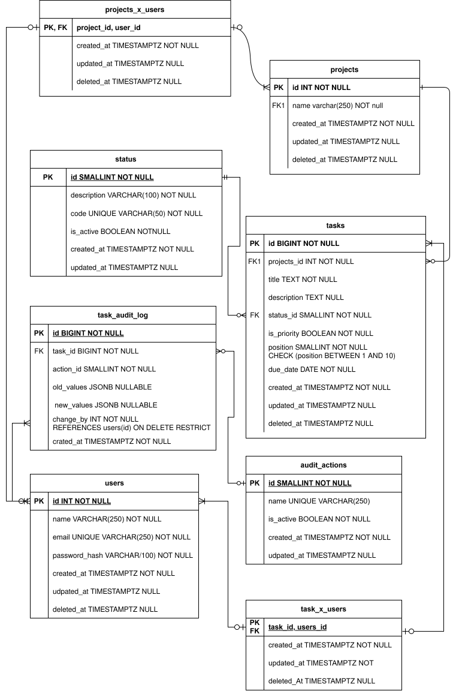

# Docker Production Stack

A hands-on DevOps portfolio project focused on building,
containerizing, and operating a web application.

## Overview

The application in this stack is **Taskify**, a task board
used to demonstrate containerization, service orchestration,
networking, persistent storage, security, and deployment
automation.

Taskify lets people assign tasks to projects and to users.
The interface is a management board in the style of Trello:
work is grouped by project, and each task can be followed
across the people who participate in it.

## Technology Stack

- **Frontend:** Next.js
- **Backend:** Fastify
- **Database:** PostgreSQL
- **Containerization:** Docker
- **Orchestration:** Docker Compose
- **Reverse Proxy:** Nginx
- **CI/CD:** GitHub Actions

## Taskify

The Next.js application is the board. The Fastify API owns
projects, tasks, membership, and assignment. PostgreSQL
stores that model.



The diagram file is [`docs/db/db_diagram.svg`](docs/db/db_diagram.svg).

## Project Goals

- Build reproducible application environments.
- Use multi-stage Docker builds.
- Isolate services using Docker networks.
- Persist application data safely.
- Apply container security best practices.
- Configure health checks and reverse proxy routing.
- Automate testing and deployment.
- Document troubleshooting and recovery procedures.

## Architecture

The application consists of a Next.js frontend, a Fastify
API, PostgreSQL, and a reverse proxy.

Detailed architecture documentation is maintained
in [`docs/architecture.md`](docs/architecture.md).

## Repository Structure

```text
.
├── backend/
├── frontend/
├── docs/
│   └── db/
│       └── db_diagram.svg
├── nginx/
├── scripts/
├── compose.yml
├── .gitignore
└── README.md
```

## Project Status

- [x] Development environment verified
- [x] Initial repository created
- [x] Database diagram
- [ ] Application implementation
- [ ] Docker image builds
- [ ] Docker Compose orchestration
- [ ] Reverse proxy and security
- [ ] CI/CD pipeline
- [ ] Monitoring and recovery

## License

License to be determined.
