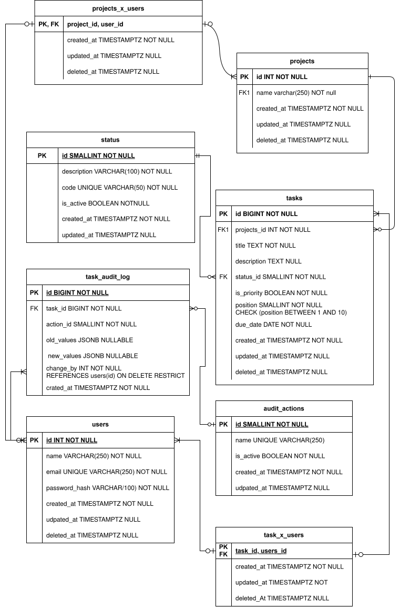

# Architecture

## Purpose

This document describes how Taskify runs on the Docker
Production Stack. Taskify is the application. The stack is
the way it is built, connected, and stored.

## Taskify

Taskify is a management board in the style of Trello. A
person belongs to a project, a task belongs to one project,
and a task is assigned to one or more users.

The board is a Next.js application. The rules live in a
Fastify API. PostgreSQL 16 stores the data.

Account recovery is part of the model. An email identifies
one user, including after the account is deactivated.
Joining a project or a task again clears `deleted_at` on
the existing membership row. It does not insert a second
row.

## Data model



The source file is [`db/db_diagram.svg`](db/db_diagram.svg).

| Area | Tables | Role |
| --- | --- | --- |
| People | `users` | Account. `email` is unique. `password_hash` stores the hash. |
| Projects | `projects`, `projects_x_users` | A project and the people who participate in it. |
| Work | `tasks`, `status`, `tasks_x_users` | A task on one project, a status from the catalog, and the users assigned to it. |
| History | `task_audit_log`, `audit_actions` | What changed on a task, who changed it, and the allowed action. |

`tasks.position` is a rank from 1 to 10. A higher number is
more important, and two tasks may share the same rank.
`tasks.due_date` is a calendar date.

`changed_by` references `users` with `ON DELETE RESTRICT`.
Deleting a user who already appears in the history is
rejected.

`projects` and `tasks` use `deleted_at` for deactivation.
`projects_x_users` and `tasks_x_users` use it to keep the
record that someone participated. A null `deleted_at` means
the row is active.

## Runtime

`compose.yml` defines three services on one Compose
network.

```text
browser
  ├── frontend :3000   Next.js
  └── backend  :8001   Fastify
           │
           └── db :5432 PostgreSQL 16
```

| Service | Image or build | Container | Published port |
| --- | --- | --- | --- |
| `frontend` | `frontend/Dockerfile` | `docker-production-fe` | `${FRONTEND_PORT}:3000` |
| `backend` | `backend/Dockerfile` | `docker-production-be` | `${API_PORT}:8001` |
| `db` | `postgres:16-alpine3.23` | `docker-production-db` | `5432:5432` |

The frontend starts after the backend. The backend starts
after the database. Both application services read `.env`.
The database reads `DB_USER`, `DB_PASSWORD`, and `DB_NAME`.
The API connects with `DATABASE_URL`.

The frontend image is a multi-stage build. The final stage
runs as the `node` user and serves the Next.js standalone
server. The backend image is also multi-stage and listens
on `8001`.

## Target edge

Nginx is the intended public entry point. It should route
the board and the API, and it should be the only published
HTTP port.

The database port is published today so the schema can be
developed from the host. The target is to keep PostgreSQL
on the Compose network only.

Backup and restore of the database volume are still to be
documented.

## Persistence

PostgreSQL data is the named volume `postgres-data`,
mounted at `/var/lib/postgresql/data`. Removing the
container does not remove that volume.

## Security

- `.env` stays out of source control. `.env.example` lists
  the variable names only.
- The database should not remain published once the API is
  the only client.
- The frontend image already runs as a non-root user.
- Dependency versions are pinned in the lockfiles.
- History rows keep a user through `ON DELETE RESTRICT`.
